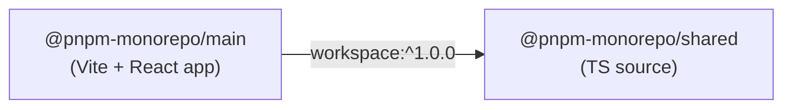

# pnpm-monorepo

A minimal, working reference for a **pnpm workspaces** monorepo: a Vite + React + TypeScript app that consumes a shared TypeScript package from the same repo, with no publishing step and no build step for the shared code.

It's meant to be read in five minutes and copied as a starting point.

## Structure

```
pnpm-monorepo/
├── pnpm-workspace.yaml      # declares packages/** as workspace packages
├── tsconfig.base.json       # strict compiler options shared across packages
├── tsconfig.json            # root config, extends the base
└── packages/
    ├── main/                # @pnpm-monorepo/main — Vite + React 18 + TS app
    │   └── src/App.tsx      # imports from @pnpm-monorepo/shared
    └── shared/              # @pnpm-monorepo/shared — plain TS module
        └── index.ts
```



## How it works

- **Workspace linking.** `main` depends on `"@pnpm-monorepo/shared": "workspace:^1.0.0"`. The `workspace:` protocol makes pnpm symlink the local package into `main/node_modules` instead of looking it up on the npm registry, so edits to `shared` show up in `main` immediately.
- **Source-only internal package.** `shared` ships raw TypeScript and has no build of its own. Vite compiles it as part of the app bundle, which keeps the inner loop fast and avoids a `dist/` that can drift out of sync with the source.
- **One install, one lockfile.** A single `pnpm install` at the root installs every package. pnpm's content-addressable store and strict, non-flat `node_modules` mean each package can only import what it actually declares as a dependency, so missing dependencies show up as errors instead of working by accident.

## Getting started

Requires **Node 18+** and **pnpm 7**. The committed lockfile is format 5.4. Newer pnpm versions reject it (pnpm 9 fails with `ERR_PNPM_LOCKFILE_BREAKING_CHANGE`).

```bash
npx pnpm@7 install

# run the app (http://localhost:5173)
npx pnpm@7 --filter @pnpm-monorepo/main dev

# type-check and production build
npx pnpm@7 --filter @pnpm-monorepo/main build
```

If pnpm 7 is already installed globally, drop the `npx pnpm@7` prefix and use `pnpm`.

## Adding a package

1. Create `packages/<name>/package.json` with a scoped name, e.g. `@pnpm-monorepo/<name>`.
2. Depend on it from another package: `pnpm --filter @pnpm-monorepo/main add @pnpm-monorepo/<name>@workspace:*`
3. Run `pnpm install` at the root.

## Trade-offs and next steps

This repo is intentionally small. What a production setup would add:

- **Task orchestration and caching**, using Turborepo or Nx, so that `build`, `lint` and `test` run only for the packages that changed.
- **Built internal packages** (`tsup`/`tsc` emitting `dist/` plus `.d.ts`) once `shared` is consumed by something other than a bundler, such as a Node service.
- **TypeScript project references** across packages, for incremental type-checking.
- **Shared lint/format config** and a CI workflow.
- **Versioning with Changesets**, if any package is ever published.
